

  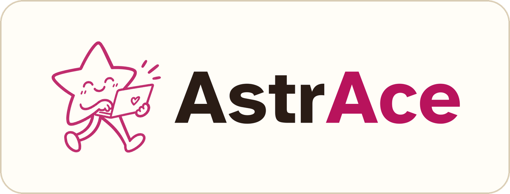

<b>"Ciência feita por meninas e mulheres!"</b>

Plataforma web que dá visibilidade, pertencimento e caminho de carreira a meninas e mulheres na ciência. O AstrAce reúne em um só lugar um mural de projetos, agenda de eventos, vagas afirmativas, notícias científicas e um passaporte de carimbos, tudo com cara de mural de cortiça e pensado para ser acessível.

🌐 **Site no ar:** https://helenavieira.pythonanywhere.com

Projeto desenvolvido para o **Hackathon Ciência Delas**.

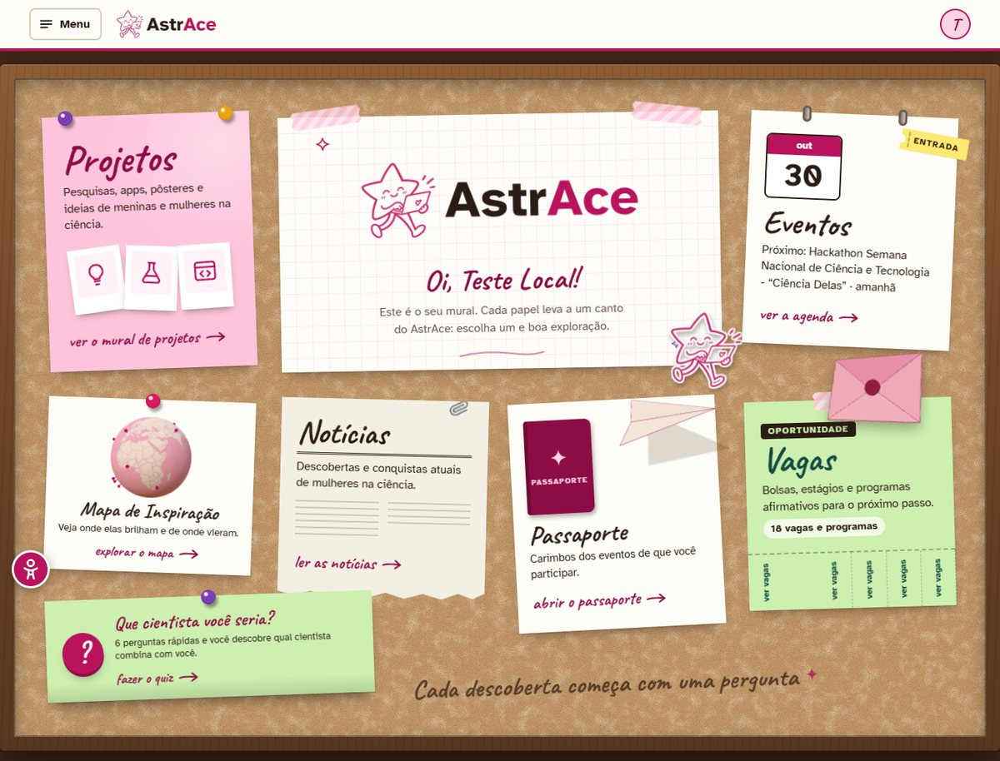

## 🛠️ Funcionalidades

- [x] **Mural de projetos:** pesquisas, apps, pôsteres e ideias de meninas e mulheres, com filtros, estrelas e destaque da semana.
- [x] **Eventos:** agenda com filtros. Eventos que valem carimbo geram um QR code para o check-in.
- [x] **Vagas afirmativas:** bolsas, estágios e programas para o próximo passo na carreira.
- [x] **Notícias:** descobertas e conquistas atuais de mulheres na ciência.
- [x] **Passaporte 3D:** um carimbo de boas-vindas e um para cada evento de que a pessoa participa.
- [x] **Certificados:** depois do evento, quem fez o check-in emite o certificado de participação.
- [x] **Carta para o futuro:** uma carta para a cientista que você vai ser, selada em um envelope 3D até a data escolhida.
- [x] **Mapa de Inspiração:** cientistas da história e as mulheres e projetos do AstrAce, por cidade.
- [x] **Quiz "Que cientista você seria?"**
- [x] **Perfil:** publicações, carta e certificados da pessoa.
- [x] **Painel da equipe:** cadastro de eventos, vagas e notícias e revisão de denúncias.
- [x] **Login com Google**, sem senha própria.
- [x] **Acessibilidade:** menu com contraste, tamanho do texto, fonte para dislexia, leitura em voz alta e mais.

## 📸 Um passeio pelo site

### Mural de projetos
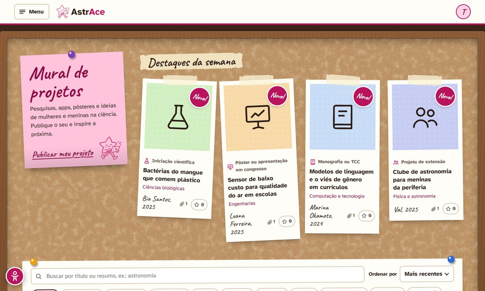

### Eventos e vagas
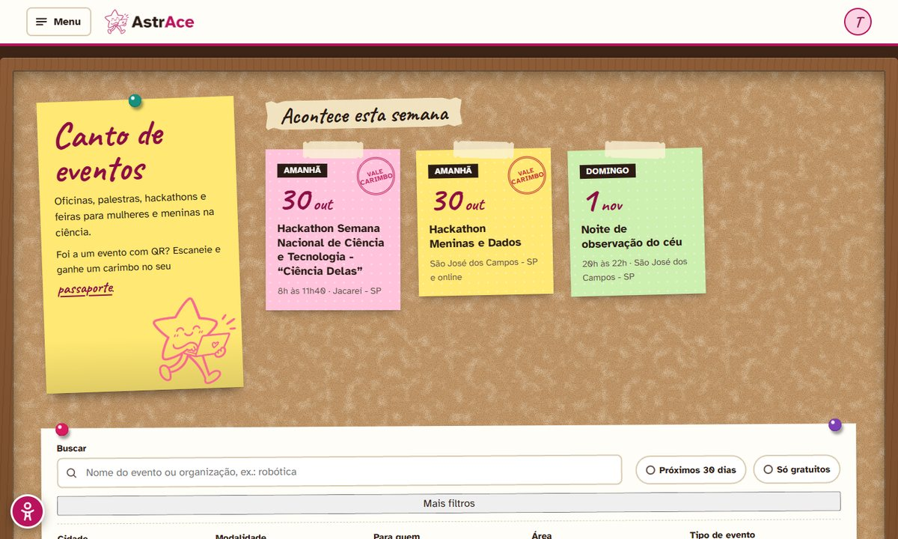
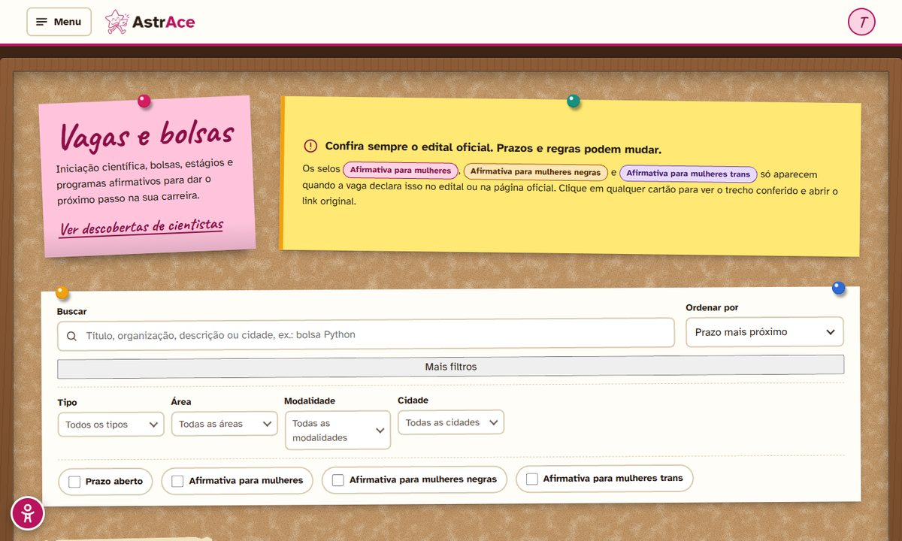

### Notícias
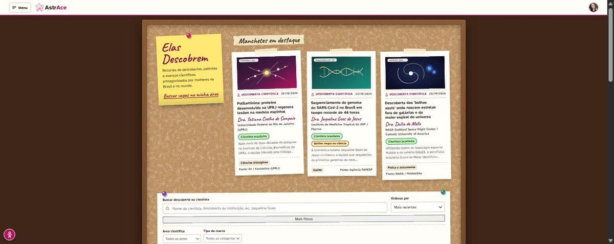

### Passaporte e certificados
Cada evento de que a pessoa participa rende um carimbo no passaporte.

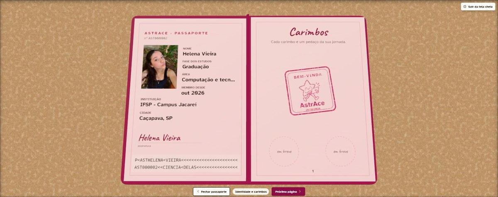

### Carta para o futuro
A carta fica selada e só abre na data escolhida.

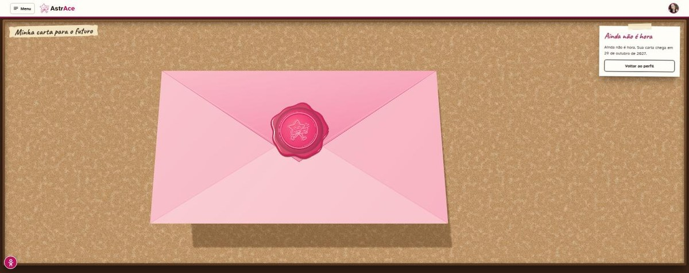

### Mapa de Inspiração e quiz
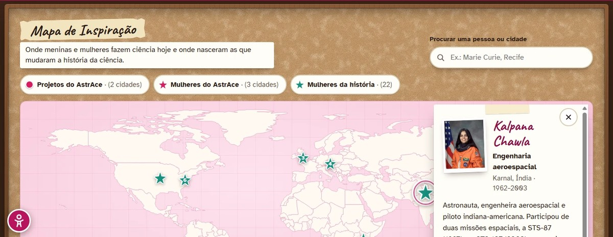
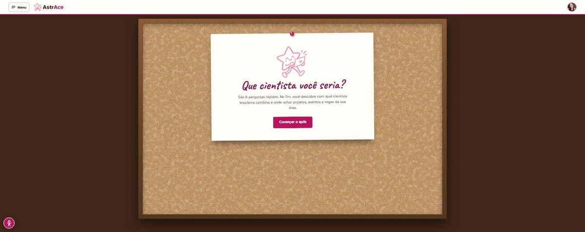

### Perfil
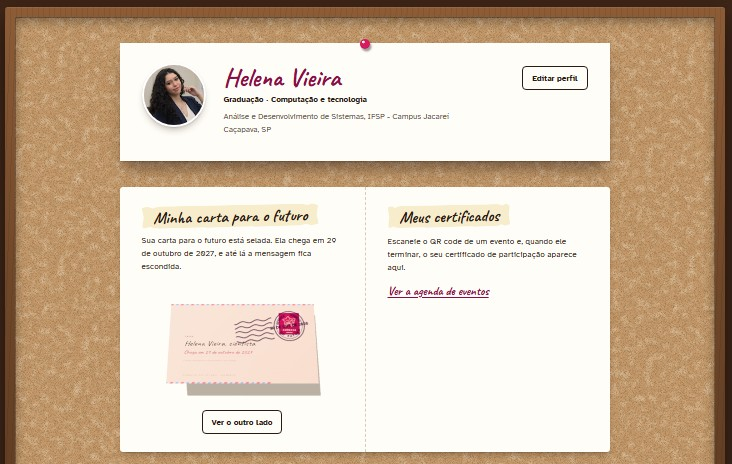

### Painel da equipe
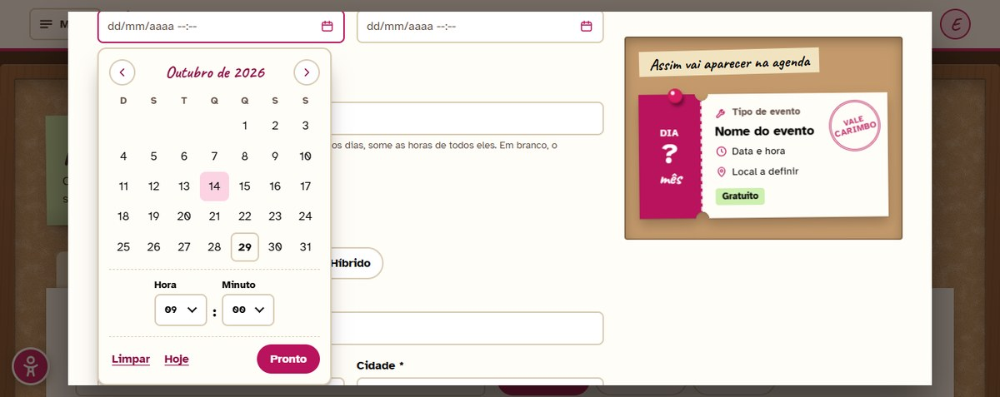

### Acessibilidade
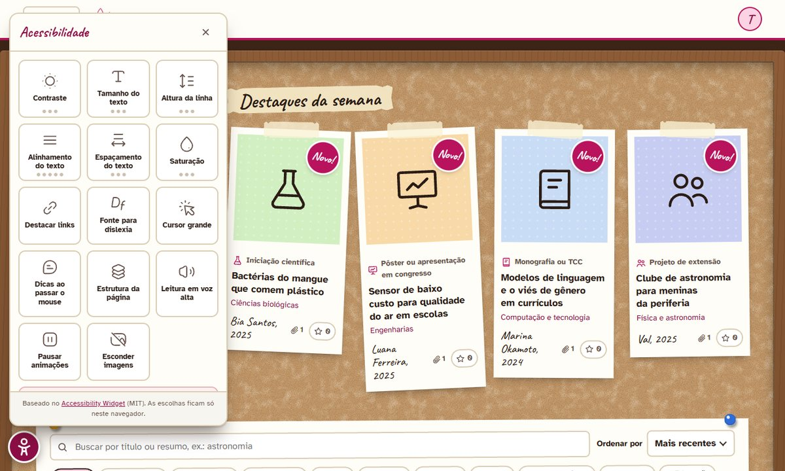

## 💻 Tecnologias

- **Python e Flask:** servidor e regras de negócio
- **SQLAlchemy com SQLite** (MySQL opcional)
- **HTML, CSS e TypeScript:** interface web
- **Three.js:** passaporte, carta e outros elementos em 3D
- **Google OAuth:** login
- **pytest:** testes automatizados
- **PythonAnywhere:** hospedagem gratuita

## ☁️ Hospedagem

O site roda no **PythonAnywhere** (plano gratuito), com o banco e os arquivos enviados no mesmo lugar. Para atualizar: `git pull` no console do servidor e **Reload** na aba Web. No plano gratuito é preciso renovar o site uma vez por mês.

## 🙏 Créditos

- Widget de acessibilidade adaptado de [junanobi/accessibility-widget](https://github.com/junanobi/accessibility-widget) (licença MIT).

## 👥 Equipe

- [Helena Vieira](https://github.com/helenavieiranasc)
- [Maria Clara Pastor](https://github.com/mariaclarapastorsilva)
- [Camila Ribeiro](https://github.com/camilaribeirox)
- [Caio Grilo](https://github.com/grilocaio)
- [Kawan Mesquita](https://github.com/kawanmt)
